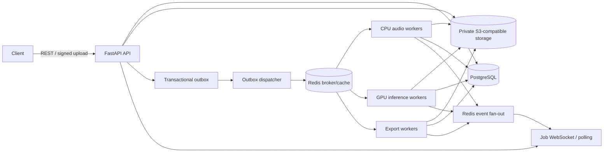
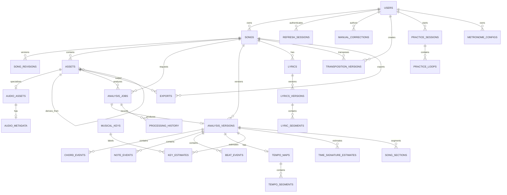

# Music Intelligence API — Technical Design Proposal

> Historical proposal. The current application is intentionally stateless and does not include the persistence, broker, media storage, or worker architecture described here.

**Status:** Design for review; no application code has been started  
**Research checked:** 2026-11-12  
**Scope:** Backend/API only; no frontend  
**Decision gate:** Approval of this proposal is required before implementation begins

## 1. Executive recommendation

Build a modular monolith with separately deployed API, CPU processing workers, GPU inference workers, and export workers. Use PostgreSQL as the source of truth; private S3-compatible object storage for media; Celery for asynchronous work; Redis initially for broker/cache/event fan-out, with broker durability settings and a migration path to RabbitMQ if workload/reliability tests require it. Keep every model behind a task-specific provider interface. Do not load models in FastAPI or execute decoding, inference, or exports in API requests.

Use conventional signal-processing pipelines for deterministic features and specialized transcription models for symbolic tasks. Use an audio-language model only for non-authoritative assistance such as captioning or candidate explanations. The published material reviewed does **not** justify using a general music LLM as the sole source of timestamped chords, meter, lyric alignment, or polyphonic notes.

Important conditions before selecting model weights:

1. **MOSS-Music is the strongest broad music-language-model candidate reviewed for commercial use**: its model card states Apache-2.0. It is large (about 9.05B BF16 parameters / 18.1 GB repository storage for the Instruct checkpoint), CUDA-oriented, and does not publish a minimum VRAM or CPU performance. Its own project-reported benchmark does not yet establish chord accuracy or singing word timestamps.
2. **Music Flamingo's current checkpoint is non-commercial research only** according to its model card. Do not ship it without a separate license.
3. **Essentia is AGPL-3.0**, and its chord detector is expressly described as experimental and error-prone. Commercial use is not itself prohibited by AGPL, but the intended network/service and distribution model needs legal review or a commercial license.
4. **Basic Pitch** is a compact, Apache-2.0 candidate for single-instrument note transcription, but its documented supported Python versions do not establish Python 3.12 compatibility.
5. **Whisper/WhisperX** are useful baselines for speech transcription and speech word alignment, not validated singing transcription/alignment. The aligner checkpoints have separate licenses.
6. **No production-ready, commercially clear time-signature solution with verified accuracy was established** in the reviewed sources. Beat/downbeat tracking is not synonymous with meter classification.

All model metrics below are either explicitly labelled as project-reported or marked unavailable. They are not cross-model rankings: datasets, tasks, checkpoints, and metrics differ. We must run a rights-cleared evaluation set before setting acceptance thresholds.

### Baseline assumptions

- Each song belongs to one user; organization/team tenancy is deferred.
- Audio is uploaded directly to object storage using short-lived signed URLs. The API never proxies large files by default.
- Database and application code are private; user-owned data is isolated by object-level authorization on every request.
- Production storage is an S3-compatible service; local filesystem storage is for development/single-host testing only.
- Local inference is the default evaluation path. Any hosted model provider requires explicit privacy, residency, retention, cost, and licensing approval.
- Python 3.12 is the initial tested minimum. Python 3.13+ is enabled only after a dependency and native-wheel compatibility matrix passes.
- Audio and model processing is asynchronous. Synchronous endpoints are limited to bounded metadata/CRUD and deterministic small calculations.
- File duration, file-size, concurrency, storage, and GPU budgets are product decisions to set before launch.

## 2. Technology evaluation

| Area | Preferred baseline | Alternatives / decision notes |
|---|---|---|
| HTTP API | FastAPI + Pydantic v2 | Good typed request/response and OpenAPI surface. Keep routers thin; use application use cases, not route-level business logic. API worker count/container scaling is independent of CPU/GPU workers. FastAPI's worker/container guidance supports this deployment separation: [server workers](https://fastapi.tiangolo.com/deployment/server-workers/). |
| Relational persistence | PostgreSQL + SQLAlchemy 2 + Alembic | PostgreSQL enforces referential, check, unique, and partial-index constraints. Use SQLAlchemy 2 typed mappings and explicit repositories. Use synchronous ORM calls in ordinary `def` routes (FastAPI executes sync routes in its thread pool) or consistently use SQLAlchemy asyncio for async routes; do not make synchronous DB calls directly inside `async def`. Select one API DB mode during Phase 0. Workers may use a sync engine. [Constraints](https://www.postgresql.org/docs/current/ddl-constraints.html), [partial indexes](https://www.postgresql.org/docs/current/indexes-partial.html), [SQLAlchemy asyncio](https://docs.sqlalchemy.org/en/20/orm/extensions/asyncio.html). |
| Queue/workflows | Celery + Redis to start | Celery is suitable for named queues, retries, worker pools, and routing. Redis transport is supported, but has visibility-timeout/redelivery caveats; do not treat Celery result backend or Redis Pub/Sub as the durable job ledger. Evaluate RabbitMQ as a broker if production queue durability/isolation requirements outgrow Redis. Alternatives: RQ/Dramatiq for simpler job models; Temporal for durable, long-lived workflow orchestration at the cost of a new service and operating model. [Celery task semantics](https://docs.celeryq.dev/en/stable/userguide/tasks.html), [Redis transport](https://docs.celeryq.dev/en/stable/getting-started/backends-and-brokers/redis.html), [routing](https://docs.celeryq.dev/en/stable/userguide/routing.html). |
| Object storage | S3 API abstraction (`boto3` adapter) | Production S3 or compatible service; MinIO for development/integration. Use generated object keys, private buckets, multipart upload for large files, versioned immutable outputs, and short-lived presigned transfers. Signed URLs are bearer capabilities and may overwrite the target key, so issue unique, one-time staging keys and verify checksum/size after upload. [S3 presigned uploads](https://docs.aws.amazon.com/AmazonS3/latest/userguide/PresignedUrlUploadObject.html). |
| Decode/probe/convert | FFmpeg + FFprobe subprocess adapter | Use FFprobe for container/stream facts and FFmpeg for canonical decode/encode. Invoke with argument arrays (never shell strings), strict time/resource limits, controlled protocols, and a private temp directory. Build/distribution license depends on FFmpeg configuration and enabled codecs; audit the shipped binary and codecs. [FFprobe](https://ffmpeg.org/ffprobe.html). |
| Embedded tags | Mutagen | Extract ID3 and container tags as untrusted claims; use FFprobe for actual stream format/duration. Keep tag extraction separate from canonical song fields. |
| Signal processing | NumPy/SciPy/librosa | Good CPU baseline for features, chroma, onset, tempo experiments, pitch/time transforms, and tests. Pin compatible versions only after Python 3.12/3.13, NumPy, and native wheels are tested. Librosa's code license is ISC; that does not license user audio or third-party models. |
| Advanced audio algorithms | Essentia, conditionally | Broad MIR algorithms, but AGPL-3.0 and varying algorithm maturity are material commercial constraints. Put it behind an adapter and a separate worker image; use only after license approval and dataset validation. Do not assume its `ChordsDetection` accuracy is production-grade. |
| Inference runtime | PyTorch, isolated per worker image | CPU and CUDA are distinct deployment profiles. Do not install every model framework in the API image. Record model/weights hashes, preprocessing versions, library versions, device, and inference configuration for reproducibility. |
| Lyrics discovery | Licensed provider adapter | Compare LyricFind's commercial lyrics/data licensing and Lyric Search/Display products ([official site](https://www.lyricfind.com/)) with Musixmatch's developer offering ([developer portal](https://developer.musixmatch.com/)). The Musixmatch portal is account-gated and its current commercial terms/API scope could not be verified from public pages reviewed. Do not scrape. Select only after rights, territories, attribution/display rules, retention, matching coverage, quotas, and price are contractually clear. Store provider IDs and license/provenance metadata. |
| MIDI | `mido` for MIDI file/event I/O; `music21` for symbolic theory and notation | Mido documents MIDI read/write and a stable 1.3 release under MIT ([repo](https://github.com/mido/mido)). music21 documents BSD-3-Clause and Python 3.12+ ([repo](https://github.com/cuthbertLab/music21)). Separate event editing from file I/O; validate tempo maps, PPQ, channels, note ordering, and music21 parser/rendering behavior in the chosen image. |
| MusicXML/PDF | `music21` MusicXML generation plus isolated notation renderer | Keep notation generation deterministic and sandboxed. Rendering engines (for example MuseScore/LilyPond) have independent licenses, native dependencies, fonts, and operational constraints; choose after a legal/container spike. |
| Pitch shift/time stretch | Rubber Band as quality candidate; librosa phase-vocoder as permissively licensed baseline | Rubber Band supports independent pitch/tempo adjustment and has a v4.0 release dated 2024-10-25, but is GPL for open-source distribution; proprietary commercial distribution requires a paid license ([official site/license](https://breakfastquay.com/rubberband/)). The phase-vocoder route avoids that particular commercial license but can have audible artifacts; benchmark quality, latency, and pitch/time invariance before selection. |
| Tests/quality | pytest, property-based tests, test containers, audio fixtures | CPU unit/integration suite on every change; model-quality and GPU tests on a controlled runner. Maintain a versioned, rights-cleared benchmark corpus. |

### AI model and MIR candidate evaluation

“Supported input” below distinguishes waveform/model inputs from user-upload container formats. These models generally consume decoded audio tensors, not arbitrary uploads; the service must first probe, decode, resample, and normalize audio through a versioned preprocessing contract. Unknown means the reviewed official material does not substantiate the claim.

| Task / candidate | Availability, architecture, size | Hardware, inference, input | License, evaluation, status, recommendation |
|---|---|---|---|
| **Music understanding — MOSS-Music** | Public project and Hugging Face Instruct checkpoint. Audio encoder → adapter → LLM; documentation describes 12.5 Hz audio representations, cross-layer feature injection, and time markers. Two released models are about 9.1B parameters; Instruct metadata says 9.05B BF16 and about 18.1 GB repository storage. [Repo](https://github.com/OpenMOSS/MOSS-Music), [model card](https://huggingface.co/OpenMOSS-Team/MOSS-Music-8B-Instruct). | Project recommends Python 3.12, CUDA 12.8/PyTorch and SGLang. No verified minimum VRAM, CPU serving mode/performance, or general container-format support was found. Use its specified preprocessing/serving path; API inputs must be decoded audio. | Model card states Apache-2.0. Project reports 80.38 average accuracy over eight music-QA benchmarks and 15.88% unweighted WER/CER average across MUSDB18, MIR-1K, Opencpop; project-reported, not independently verified and not comparable to other rows. Chord results and detailed singing timestamp results are stated as pending. Recommend only for optional music QA/captioning and candidate annotations; benchmark before relying on output. |
| **Music understanding — Music Flamingo** | Public `music-flamingo-2601-hf` checkpoint; current card reports 8.27B BF16 parameters and audio+text prompting, with up to 20-minute input. The older `music-flamingo-hf` is marked superseded. [Current card](https://huggingface.co/nvidia/music-flamingo-2601-hf), [research repo](https://github.com/NVIDIA/audio-flamingo/tree/music_flamingo), [paper](https://arxiv.org/abs/2511.10289). | Model card documents audio/text input and a 20-minute cap. Current checkpoint's minimum VRAM and CPU performance were not verified. Older card hardware guidance (A100/H100/Linux) must not be assumed to apply to the current checkpoint. | Current model card says non-commercial research only. Exclude from a commercial production build unless separately licensed. Do not transfer older checkpoint benchmarks to current weights. |
| **Chords — Essentia `ChordsDetection`** | Available as a signal-processing algorithm using harmonic pitch-class profiles; major/minor triads. Not a neural model. [Official reference](https://essentia.upf.edu/reference/streaming_ChordsDetection.html). | CPU MIR pipeline; uses decoded audio/features. No model VRAM requirement. Actual file support is determined by the decode adapter. Validate algorithm frame/hop and analysis rate. | Essentia is AGPL-3.0. Its documentation calls this algorithm “experimental (prone to errors).” No benchmark in the reviewed reference establishes commercial-song chord accuracy. Use as a baseline only after legal review; compare to human labels and neural candidates. |
| **Chords — MOSS-Music** | Model-level chord recognition is claimed, but detailed chord results are explicitly pending in project material. See MOSS row above. | Large CUDA-oriented model; no verified minimum VRAM/CPU or chord-specific inference contract. | Apache-2.0 model license, but no verified chord benchmark is not an accuracy guarantee. Treat as research candidate, not primary chord transcriber. |
| **Polyphonic notes — Spotify Basic Pitch** | Public lightweight AMT; instrument-agnostic, best on one instrument at a time; polyphonic note events/MIDI and pitch bends. Repository includes TensorFlow/CoreML/TFLite/ONNX variants; listed ONNX file is 230,444 bytes and TFLite 204,448 bytes. [Repo/docs](https://github.com/spotify/basic-pitch), [models](https://github.com/spotify/basic-pitch/tree/main/basic_pitch/saved_models/icassp_2022). | Model processing downmixes to mono, uses 22.05 kHz audio and two-second windows. ONNX/TFLite are practical CPU deployment candidates; exact throughput/hardware minimum was not published. User uploads must be decoded first. README lists Windows/macOS/Ubuntu and Python through 3.11; Python 3.12 compatibility is unverified. | Apache-2.0. No specific benchmark result is asserted here. Best compact first candidate for isolated-instrument note transcription; benchmark on guitar, bass, piano, and ukulele recordings separately before claiming instrument coverage. |
| **Polyphonic/multitrack notes — MT3** | Public Magenta research implementation; T5X-based multi-instrument transcription with piano and multi-instrument checkpoints. [Repo](https://github.com/magenta/mt3), [ICLR paper](https://openreview.net/pdf?id=iMSjopcOn0p). | T5X/JAX research stack; no verified production GPU minimum, CPU performance, checkpoint size, or Python 3.12 compatibility. Input is decoded model audio, not general file containers. The repository says training is not readily supported. | No clearly stated commercial license for both released code and checkpoints was verified. Do not deploy pending rights and reproducibility review. Published paper results are research-task-specific, not a production quality guarantee. |
| **Singing transcription baseline — OpenAI Whisper** | Public encoder-decoder Transformer ASR, multiple model sizes/checkpoints. [Repo and model-size information](https://github.com/openai/whisper). | Decoded audio; official usage guidance reports approximate VRAM from about 1 GB for tiny/base to about 10 GB for large, and about 6 GB for turbo. These are Whisper speech-inference estimates, not singing quality guarantees. Supports CPU execution in its implementation, with speed dependent on model/device. Input containers are decoded/resampled by the service. | Code and model weights are MIT. Speech benchmarks do not establish singing ASR. Use as a speech baseline and a singing candidate only after vocal-focused evaluation; an optional vocal stem may help but adds separation artifacts. |
| **Word timing — WhisperX** | Public Whisper transcription + forced alignment pipeline; alignment uses language-specific wav2vec2/phoneme models. [Repo](https://github.com/m-bain/whisperX), [alignment code](https://github.com/m-bain/whisperX/blob/main/whisperx/alignment.py). | Supports GPU and CPU-int8 paths. Its under-8-GB GPU statement is for a particular large-v2 ASR configuration (beam size 5), not a universal alignment requirement. Takes decoded audio and text/transcript; alignment checkpoints are language-specific. | Code BSD-2-Clause; each aligner checkpoint has its own terms. Speech/phoneme alignment does not verify lyric timing on sung audio. Do not make it the authoritative sung-word aligner without benchmark evidence. |
| **Source separation — Demucs v4 / Hybrid Transformer Demucs** | Public mature four-stem separator (vocals, drums, bass, other), hybrid time/spectral processing. [Repo](https://github.com/facebookresearch/demucs). | Decoded mixture audio; no verified exact model download size or minimum VRAM was established in reviewed material. Use as a dedicated worker with bounded duration/temporary storage. Benchmark throughput and OOM behavior on target GPU. | Code is MIT; check each checkpoint separately. README reports MUSDB-era SDR comparisons, but those are not reproduced here as a universal quality figure. v4 release is old (2022 in README) and maintainer activity is low; low-maintenance risk. Suitable as a benchmark candidate, not an assumed winner. |
| **Source separation — BS-RoFormer / Mel-Band RoFormer** | Band-split frequency representations with temporal attention; implementation and pretrained checkpoint collections are distributed separately. [Implementation](https://github.com/lucidrains/BS-RoFormer), [checkpoint/training collection](https://github.com/ZFTurbo/Music-Source-Separation-Training). | Decoded audio in the selected implementation; no single standardized checkpoint, exact weight size, universal input profile, CPU/GPU memory requirement, or Python 3.12 guarantee was verified. | No blanket commercial license for all implementations/checkpoints/training data was established. Evaluate only with a specific checkpoint, source, and legal review. Do not infer the weight license from the architecture or repository code license. |
| **Beat/BPM/key/chords — Essentia** | Classical MIR algorithms, not one model; RhythmExtractor2013, KeyExtractor and chord algorithms. [Rhythm](https://essentia.upf.edu/reference/streaming_RhythmExtractor2013.html), [key](https://essentia.upf.edu/reference/streaming_KeyExtractor.html). | CPU-oriented algorithms. RhythmExtractor2013 expects 44.1 kHz input; normalize/resample explicitly. Decoding remains an FFmpeg concern. | AGPL-3.0; license review required. Algorithm docs do not provide a shared, independent benchmark. Key/tempo are credible classical baselines; chord documentation itself warns about errors. Reviewed docs did not establish a robust explicit time-signature classifier. |
| **Beat tracking — librosa** | Public Python MIR/signal-processing library; conventional onset/tempo/beat tracking, not a trained music understanding model. [Repo/docs](https://github.com/librosa/librosa). | CPU feature processing on decoded waveforms; container support is delegated to the chosen audio backend. No GPU or model-weight requirement. | ISC license. No benchmark or maintenance activity claim is made here. Good reproducible baseline; downbeats and meter require separate logic/evaluation. |
| **Beat/downbeat — madmom** | Public Python MIR library with RNN beat/downbeat processors and chord functions. [Repo](https://github.com/CPJKU/madmom). | CPU inference is available in its research stack; model/data specifics and modern Python 3.12 compatibility need a compatibility spike. It consumes decoded audio/features, not uploads directly. | Source code BSD; model/data files are CC BY-NC-SA 4.0 according to repository licensing. Do not ship those pretrained assets commercially without permission. Repository maintenance and compatibility risk is higher than current mainstream Python libraries; verify commit/release status at implementation lock. Downbeat tracking alone is not meter classification. |

**Recommendation by function**

- **Music QA/caption/structure:** evaluate MOSS-Music as optional GPU inference only; compare its generated observations against deterministic outputs. Do not use Music Flamingo commercially under its current non-commercial model card.
- **Chords:** first create a rights-cleared benchmark and provider interface. Evaluate Essentia only if its license is cleared, plus a specialized chord model selected after research/benchmark gate. MOSS is not yet a proven timestamped chord engine. Keep manual correction and confidence/provenance in the data model.
- **Polyphonic notes:** Basic Pitch is the first compact candidate for isolated instruments. MT3 is a research alternative, not a production default until license, runtime, and Python support are resolved.
- **Lyrics:** compare Whisper on vocal-focused recordings against human transcripts. Separate vocals only if objective evaluation shows benefit. Treat WhisperX as speech alignment, not validated singing alignment. For sung lyrics, preserve uncertain text/timing and support manual correction.
- **Source separation:** benchmark a specific Demucs checkpoint against a RoFormer checkpoint with documented weight provenance, latency, memory, artifacts, and license. No universal commercial recommendation before this check.
- **BPM/beats/key:** start with deterministic librosa; add Essentia only after legal/accuracy review. madmom pretrained weights are not commercially ready under the reviewed model/data license.
- **Time signature:** no model is selected. Build a benchmark and evaluate meter-aware beat/downbeat methods; persist “unknown/uncertain” rather than emitting false precision.

**Maintenance and compatibility signals:** MOSS-Music and Music Flamingo have released model cards/checkpoints at the research date, but their long-term release cadence is not established by the material cited here. Basic Pitch is available with documented support through Python 3.11; neither a stable 3.12 claim nor maintenance cadence was verified. MT3 states it is not an officially supported Google product and that training is not readily supported. Whisper and WhisperX have public repositories, but this review does not assert a release cadence or guaranteed compatibility for every dependency. Demucs v4's README describes a 2022 release and reduced maintainer involvement. BS-RoFormer has multiple implementations/checkpoint collections rather than one canonical production artifact. Official docs exist for Essentia/librosa, but current maintenance cadence and version support must be verified during the Phase 0 compatibility build. madmom has legacy/research-stack and non-commercial pretrained-asset constraints; verify maintenance and runtime compatibility before use. “Current” here means the cited public artifact/card exists as checked on the date above; it is not an SLA or support commitment.

### Compatibility and model-release policy

Before pinning dependencies, run a clean-container matrix for Python 3.12 (required) and proposed newer versions against PostgreSQL drivers, Celery, FFmpeg bindings, PyTorch/CUDA, librosa/NumPy, Essentia, Basic Pitch/ONNX, WhisperX alignment packages, and each required model checkpoint. Package model stacks into independent worker images. Record the exact source URL, commit/release, model hash, code license, weight license, data license, Python/framework/CUDA versions, sample-rate/channel contract, supported task, benchmark snapshot, known limitations, and approval owner in a model registry. A model/code update cannot silently change old analysis results; create a new analysis version.

## 3. System architecture



### Boundaries

- **API/application:** authentication, authorization, schema validation, pagination, idempotency, short DB transactions, signed upload/download URLs, request/job creation, and job status reads. No model imports, FFmpeg invocations, file parsing, or large transfers through API memory.
- **Domain/business logic:** song ownership, asset lifecycle, analysis versioning, correction policy, transposition, quotas, and export eligibility. Framework-independent Python.
- **Audio pipeline:** FFprobe metadata extraction, decode/resample/channel normalization, loudness/format conversion, previews, waveforms, and audio transforms. Each operation is a bounded, logged task.
- **Analysis/MIR:** beat/tempo, key, time signature, section, and chord algorithms. Results always include timestamps, confidence/quality provenance, analysis version, and algorithm version when available.
- **AI provider layer:** protocols by task (chords, notes, lyrics ASR/alignment, source separation, music QA). Implementations own preprocessing and provider-specific runtime. Task workers load models once per process; API cannot import this package.
- **Lyrics:** licensed discovery provider, ASR provider, alignment provider, manual version/editing, and synchronized segments are separate use cases.
- **Music theory:** pure deterministic domain functions for intervals, chord parsing, pitch classes, key-aware transposition, tunings/capo, and instrument constraints. No model required.
- **Rhythm/practice:** metronome configuration and generated click-track assets; practice sessions and loop ranges. Network API does not promise real-time metronome scheduling.
- **Persistence/storage:** SQLAlchemy repositories and Alembic migrations; object storage behind an interface. PostgreSQL owns metadata and state; object storage owns bytes.
- **Workers/export:** Celery task entry points call application use cases. CPU, GPU, and export tasks are routed to independent worker pools/images.

### Key flows

1. Client creates an upload intent. API validates ownership/quota and returns a short-lived URL for a random staging object key.
2. Client uploads directly to storage. Completion endpoint verifies object existence, measured size, checksum, and metadata before marking asset quarantined/received.
3. An outbox row commits in the same PostgreSQL transaction as the job. Dispatcher publishes a Celery message. A sweeper republishes undispatched rows.
4. Validation worker inspects a quarantined file, probes with FFprobe, decodes a bounded sample, scans if configured, and either rejects it with a typed failure or marks it ready and creates derived assets.
5. Analysis request creates an immutable job input/options snapshot. Worker computes to attempt-specific staging keys, validates outputs, commits result rows and analysis version transactionally, then marks job terminal. Failed attempts never overwrite a prior successful version.
6. WebSocket messages are low-latency notifications only. HTTP job status/result and PostgreSQL are authoritative; clients reconnect or poll after disconnect.

## 4. Database design

Use UUID primary keys for every entity; generate IDs in the application (UUIDv4 initially; UUIDv7 can be selected after PostgreSQL/driver support and index behavior are confirmed). Store UTC timestamps as `timestamptz`. Use Alembic migrations. Keep queryable events relational; large waveforms, debug traces, and dense model outputs belong in object storage with a manifest/checksum.

### Entity inventory and relationships

| Entity | Important fields / relationships |
|---|---|
| `users` | `id`, normalized unique email, password hash or external identity reference, status, quota tier, created/updated/deleted timestamps. |
| `refresh_sessions` | `id`, `user_id`, hashed refresh token, token family, issued/expiry/revoked/rotated timestamps, device metadata. Never store bearer refresh tokens in plaintext. |
| `songs` | `id`, `owner_user_id`, title, artist, album, release date, duration cache, primary audio asset, optimistic `revision`, timestamps, soft-delete timestamp. |
| `song_revisions` | Immutable `song_id`, monotonically increasing revision number, actor, snapshot of mutable catalog fields, change reason and timestamp. Unique `(song_id, revision_no)`. Analysis and lyrics have their own versions. |
| `assets` | Common binary object record: owner/song, kind, object key, original filename (sanitized display only), MIME claim, measured bytes, SHA-256, storage provider, lifecycle state, parent asset, created/deleted timestamps. Object key is not a user-supplied path. |
| `audio_assets` | One-to-one extension of `assets`: actual container/codec, duration, sample rate, channels, bit depth/sample format, bitrate, channel layout, and probe tool version. Separate from non-audio MIDI/MusicXML/PDF assets. |
| `audio_metadata` | One-to-one with audio asset: normalized embedded tags and raw tag payload, source, extraction timestamp, Mutagen/FFprobe versions. Do not trust tags for identity/authorization. |
| `analysis_jobs` | Owner, song, input asset, task type, queued/running/succeeded/failed/cancelled state, progress/stage, options JSON, idempotency key, attempt/limit, Celery task id, heartbeat, safe error code, timestamps. |
| `analysis_versions` | Immutable result snapshot: song/input asset/job, per-song version number, pipeline/model manifest, parameter hash, quality status, created time. One successful job can produce at most one committed version. |
| `chord_events` | Analysis version, ordinal, start/end seconds, normalized chord symbol, root/bass pitch classes, quality, confidence, source (model/manual), optional beat indices. |
| `note_events` | Analysis version, ordinal, start/end seconds, MIDI pitch, velocity, instrument/program, confidence, source, optional channel/track. Supports polyphonic transcription and MIDI-derived notes. |
| `beat_events` | Analysis version, ordinal, time seconds, beat number, downbeat flag, confidence. |
| `tempo_maps` / `tempo_segments` | One map per analysis version; base tempo/confidence and ordered segments (`start_seconds`, BPM, meter reference if known). Supports tempo changes. |
| `musical_keys` / `key_estimates` | `musical_keys` lookup (tonic pitch class + mode + canonical label, unique); estimates link an analysis version to a key, optional time range, confidence, source. |
| `time_signature_estimates` | Analysis version, start/end, numerator/denominator, confidence, source; supports unknown meter by absence/explicit unknown result. |
| `song_sections` | Analysis version, ordered start/end, label, confidence, provenance. |
| `lyrics` / `lyrics_versions` | One lyric resource per song; immutable version number, language, text, source/provider, external ID, license/provenance, actor, and timestamp. |
| `lyric_segments` | Lyrics version, ordinal, text, optional start/end, timing confidence, segment kind (line/token/phrase). Untimed lyrics remain valid. |
| `manual_corrections` | Actor, timestamp, operation, before/after JSON snapshots, reason, and exactly one typed target FK (chord event, note event, beat event, key estimate, time signature, section, or lyric segment). Corrections are append-only; materialized results create a new version. |
| `transposition_versions` | Song, source analysis version, user, semitone delta, optional capo/tuning/instrument, algorithm version, created time. Store requested transformation/provenance; derive or persist rendered chord sets without mutating source analysis. |
| `instruments` / `tunings` / `tuning_strings` | Supported instrument families (guitar, piano, bass, ukulele), named tunings and ordered string pitch/MIDI note definitions. Presets are versioned; user custom tuning may be owned. |
| `metronome_configs` | Owner, BPM, numerator/denominator, subdivisions, accent pattern, sound preset, optional instrument context and timestamps. |
| `practice_sessions` / `practice_loops` | Owner/song, start/end, selected analysis/transposition version, tempo multiplier, notes; loops have start/end, order, repeat behavior. |
| `exports` | Owner/song, format, source version(s), options, queued/running/terminal state, output asset, job, idempotency key, error code, timestamps. |
| `processing_history` | Append-only audit/event record for job/asset/song transitions, actor/system identity, old/new state, safe structured detail and timestamp. |
| `outbox_events` | Transactional event ID, aggregate ID/type, JSON payload, created/published/attempt timestamps; prevents DB/queue dual-write loss. |



### Integrity, indexes, and deletion

- Enforce `UNIQUE(lower(email))`, owner-scoped idempotency keys, stable per-song version numbers, unique asset object key/provider, and unique per-version event ordinal.
- Check duration/byte counts are positive, event start is nonnegative, end exceeds start, confidence is within `[0,1]`, BPM is positive, pitch class is `0..11`, time-signature numerator/denominator are positive, and loop ranges fit known song duration. Enforce supported state transitions in application logic and critical invariants in constraints.
- Store event times as `NUMERIC(12,6)` or another measured precision chosen by benchmark; use the same unit (seconds) in JSON. Decide on rounding/tolerance in the contract.
- Index `(owner_user_id, created_at, id)` for song pagination; `(song_id, created_at)` and `(status, created_at)` for jobs; `(analysis_version_id, start_seconds, ordinal)` for events; `(lyrics_version_id, ordinal)`; `(practice_session_id, ordinal)`; and foreign-key lookup columns.
- Use partial indexes for active/unpublished work and active idempotency keys where query patterns justify them. Validate plans with production-shaped data; indexes are not added speculatively.
- `RESTRICT` deletion of assets/versions while referenced by analyses or exports. Song delete is soft-delete followed by an explicit retention/purge workflow. Purge object bytes only after references, retention windows, legal holds, and audit requirements are checked. User deletion revokes auth immediately, then anonymizes/deletes owned data according to an approved policy. Do not cascade-delete audit history.
- Every owner-scoped resource lookup must include ownership in the query. PostgreSQL RLS may be added as defense in depth, not as a substitute for application checks; table owners can bypass RLS unless configured appropriately. [PostgreSQL RLS](https://www.postgresql.org/docs/current/ddl-rowsecurity.html).

## 5. REST API contract (`/api/v1`)

Use `/api/v1` for all HTTP endpoints. JSON uses snake_case, UTC ISO-8601 timestamps, UUID strings, and seconds for audio offsets. Create operations return `201` unless work is asynchronous (`202`). Add `ETag`/`If-Match` for mutable song/lyrics records where lost updates matter.

### Canonical request/response shapes

These are shared contract shapes; resource-specific responses omit fields not relevant to that operation.

```json
{
  "song": {
    "id": "uuid",
    "title": "string",
    "artist": "string|null",
    "album": "string|null",
    "duration_seconds": 0.0,
    "primary_asset_id": "uuid|null",
    "revision": 1,
    "created_at": "2026-11-12T00:00:00Z"
  },
  "upload_intent": {
    "asset_id": "uuid",
    "method": "PUT",
    "url": "short-lived signed URL",
    "headers": {"content-type": "audio/mpeg"},
    "expires_at": "2026-11-12T00:15:00Z"
  },
  "analysis_job": {
    "id": "uuid",
    "song_id": "uuid",
    "status": "queued|running|retry_wait|succeeded|failed|cancelled",
    "progress": 0,
    "stage": "string|null",
    "analysis_version_ids": [],
    "error": {"code": "string", "retryable": false},
    "created_at": "2026-11-12T00:00:00Z"
  },
  "chord_event": {
    "id": "uuid",
    "start_seconds": 0.0,
    "end_seconds": 1.0,
    "symbol": "Am7",
    "root_pitch_class": 9,
    "bass_pitch_class": null,
    "confidence": 0.0
  },
  "page": {"items": [], "next_cursor": "opaque|null", "has_more": false}
}
```

`AnalysisJobCreate` requires `{asset_id, tasks, options}`; `Idempotency-Key` is an HTTP header (not a trustable request-body field). `UploadIntentCreate` requires `{filename, content_type, size_bytes, sha256, purpose}`. `LyricVersionCreate` requires `{language, text, segments?}` and each segment is `{ordinal, text, start_seconds?, end_seconds?, confidence?}`. `ExportCreate` requires `{format, source_version_ids?, options}`. All response schemas are explicit Pydantic DTOs; ORM entities and raw provider payloads are never serialized directly.

### Authentication and account

| Method and path | Request / response responsibility |
|---|---|
| `POST /auth/register` | `{email,password}` → `201 UserPublic`; apply verification/rate-limit policy. |
| `POST /auth/login` | `{email,password}` → access token + refresh token/session (or secure cookies, a deployment decision). |
| `POST /auth/refresh` | Rotates refresh token/session; detects refresh-token reuse. |
| `POST /auth/logout` | Revokes current refresh-token family/session; idempotent. |
| `GET /users/me` | Returns authenticated user's safe public profile/quota. |
| `PATCH /users/me` | Updates explicitly allowed profile fields; never mass-assign roles/quota. |

### Songs, assets, and metadata

| Method and path | Request / response responsibility |
|---|---|
| `GET /songs?cursor&limit&query&sort` | Cursor-paginated owned songs; filters title/artist, sort allowlist. |
| `POST /songs` | `{title,artist?,album?,release_date?}` → song and initial revision. |
| `GET /songs/{song_id}` | Owned song summary and current asset/version IDs. |
| `PATCH /songs/{song_id}` | Partial allowlisted metadata update; requires `If-Match` or revision. |
| `DELETE /songs/{song_id}` | Soft delete and enqueue governed cleanup; `204`. |
| `GET /songs/{song_id}/revisions` | Song catalog revision history. |
| `POST /songs/{song_id}/uploads` | `{filename,content_type,size_bytes,sha256,purpose}` → asset ID, upload method/URL/headers/expiry. |
| `POST /songs/{song_id}/uploads/{asset_id}/complete` | `{size_bytes,sha256}` → validate storage receipt and queue validation. |
| `GET /songs/{song_id}/assets` | Lists owned assets by kind/state. |
| `GET /songs/{song_id}/assets/{asset_id}` | Returns verified technical metadata and lifecycle state. |
| `POST /songs/{song_id}/assets/{asset_id}/download-url` | `{disposition?}` → short-lived signed URL after authorization. |
| `DELETE /songs/{song_id}/assets/{asset_id}` | Mark for deletion when no protected references remain. |

### Jobs and analysis

| Method and path | Request / response responsibility |
|---|---|
| `POST /songs/{song_id}/analysis-jobs` | `AnalysisJobCreate {asset_id, tasks[], options}` → `202 AnalysisJob`. Tasks include `metadata`, `convert`, `preview`, `waveform`, `beats_tempo`, `key`, `time_signature`, `sections`, `chords`, `notes`, `midi_import`, `lyrics_asr`, `lyrics_align`, `separation`, `pitch_shift`, `time_stretch`. Unsupported combinations return `422`. |
| `GET /analysis-jobs?status&song_id&cursor&limit` | Owned job list. |
| `GET /analysis-jobs/{job_id}` | Status, monotonic percent, current stage, safe error, retryability, output version IDs. |
| `POST /analysis-jobs/{job_id}/cancel` | Cooperative cancellation request; `202` if accepted, `409` if terminal/non-cancellable. |
| `GET /songs/{song_id}/analysis-versions?cursor&limit` | Immutable analysis history. |
| `GET /songs/{song_id}/analysis-versions/{version_id}` | Model/pipeline manifest and result summary. |
| `GET /songs/{song_id}/analysis-versions/{version_id}/chords` | Cursor/page of timestamped chord events. |
| `GET /songs/{song_id}/analysis-versions/{version_id}/notes` | Cursor/page of polyphonic note events with pitch, onset/offset, velocity, instrument, and confidence. |
| `GET /songs/{song_id}/analysis-versions/{version_id}/beats` | Beat/downbeat events with confidence. |
| `GET /songs/{song_id}/analysis-versions/{version_id}/tempo-map` | Base BPM and ordered tempo segments. |
| `GET /songs/{song_id}/analysis-versions/{version_id}/key-estimates` | Global/local key estimates and confidence. |
| `GET /songs/{song_id}/analysis-versions/{version_id}/time-signatures` | Meter estimates, or explicit unknown result. |
| `GET /songs/{song_id}/analysis-versions/{version_id}/sections` | Timestamped section labels. |
| `POST /songs/{song_id}/analysis-versions/{version_id}/corrections` | `CorrectionCreate {target_type,target_id,operation,before_version,after,reason?}`; validates typed target and creates a new immutable result version or correction revision. |
| `GET /songs/{song_id}/analysis-versions/{version_id}/corrections` | Correction audit history. |

### Lyrics, theory, transposition, practice, exports

| Method and path | Request / response responsibility |
|---|---|
| `GET /songs/{song_id}/lyrics` | List lyric resources/versions and provenance. |
| `POST /songs/{song_id}/lyrics` | Create manual lyrics version `{language,text}`. |
| `GET /songs/{song_id}/lyrics/{lyrics_id}/versions` | Immutable lyric history. |
| `GET /songs/{song_id}/lyrics/{lyrics_id}/versions/{version_id}` | Text and timed segments. |
| `POST /songs/{song_id}/lyrics/{lyrics_id}/versions` | Create an immutable version from `{based_on_version_id?,text?,segments?}` with optimistic concurrency. |
| `POST /songs/{song_id}/lyrics/transcriptions` | `{asset_id,language?,provider?,separate_vocals?}` → `202` lyric-transcription job. |
| `POST /songs/{song_id}/lyrics/{lyrics_id}/alignments` | `{lyrics_version_id,asset_id,language?}` → `202` alignment job. |
| `POST /songs/{song_id}/midi-imports` | `{asset_id,instrument?,tuning_id?,quantization?}` → `202` MIDI parsing/validation job; the uploaded asset must be a validated MIDI file. |
| `POST /theory/chords/parse` | `{symbol}` → normalized root/quality/extensions/bass or typed invalid-symbol error. |
| `POST /theory/transpose` | `{chord_symbols[],semitones,key?,prefer_flats?}` → transposed symbols and spelling metadata. |
| `POST /theory/intervals` | `{from_pitch,to_pitch}` → interval/pitch-class result. |
| `GET /instruments` | Supported instruments and capability metadata. |
| `GET /instruments/{instrument}/tunings` | Public standard tunings; user custom tunings are separately owner-scoped. |
| `POST /songs/{song_id}/transpositions` | `{analysis_version_id,semitones,instrument?,tuning_id?,capo?}` → immutable transposition version. |
| `GET /songs/{song_id}/transpositions` | Transposition history. |
| `GET /songs/{song_id}/transpositions/{id}` | Transposed chord view and source provenance. |
| `GET /metronome-configs` / `POST /metronome-configs` | List/create `{bpm,numerator,denominator,subdivision,accents,sound}`. |
| `PATCH /metronome-configs/{id}` / `DELETE /metronome-configs/{id}` | Owner-scoped configuration edit/delete. |
| `POST /metronome-renders` | `{config_id?,duration_seconds?,bars?}` → `202` generated click-track asset job. |
| `POST /practice-sessions` | Start session `{song_id?,analysis_version_id?,transposition_id?,metronome_config_id?}`. |
| `GET /practice-sessions?cursor&limit` / `GET /practice-sessions/{id}` | Owned sessions and detail. |
| `PATCH /practice-sessions/{id}` / `POST /practice-sessions/{id}/stop` | Update notes/finish session. |
| `GET /practice-sessions/{id}/loops` / `POST /practice-sessions/{id}/loops` | List/create `{start_seconds,end_seconds,repeat_count?}` loops. |
| `PATCH /practice-sessions/{id}/loops/{loop_id}` / `DELETE ...` | Edit/delete loop; validate against duration. |
| `GET /songs/{song_id}/exports?cursor&limit` | Export history. |
| `POST /songs/{song_id}/exports` | `{format,analysis_version_id?,lyrics_version_id?,transposition_id?,options}` → `202 Export`. Formats include MIDI, MusicXML, PDF, JSON/LRC, chord chart, audio preview/stems where supported. |
| `GET /exports/{export_id}` | Export state/metadata. |
| `POST /exports/{export_id}/download-url` | Authorized short-lived output URL. |
| `DELETE /exports/{export_id}` | Mark export/output for deletion. |

### Pagination, errors, and concurrency

- Cursor pagination uses stable keysets (typically `(created_at,id)` or `(start_seconds,ordinal)`), with `limit` capped server-side. Response: `{items,next_cursor,has_more}`. Do not expose arbitrary SQL ordering or unbounded offsets on large event tables.
- Common error body follows RFC 9457 `application/problem+json`: `{type,title,status,detail,instance,code,trace_id,errors?}`. Never expose stack traces, storage keys, tokens, file system paths, raw model prompts, or provider secrets.
- Status mapping: `400` malformed request; `401` missing/invalid auth; `403` forbidden operation; `404` absent or non-owned resource (avoid ID enumeration); `409` stale revision/idempotency/state conflict; `413` quota/size; `415` unsupported media; `422` schema/semantic validation; `429` rate/quota; `503` temporary dependency outage.
- Use standard `Retry-After` for throttling/backoff and request/trace IDs for support. RFC source: [Problem Details (RFC 9457)](https://www.rfc-editor.org/rfc/rfc9457.html).

### WebSocket job events

- `WebSocket /api/v1/jobs/{job_id}/events` (WSS in production); authenticate using a secure cookie or a short-lived, narrowly scoped connection token (never a long-lived JWT in a URL). Authorize job ownership before accepting.
- Server event envelope: `{event_id,job_id,sequence,type,occurred_at,data}`. Types: `job.queued`, `job.started`, `job.progress`, `job.retrying`, `job.succeeded`, `job.failed`, `job.cancelled`.
- Progress `data` contains stage, percent, and a safe message; never contain raw model output unless explicitly requested via an authorized result endpoint.
- Send a terminal event then close cleanly. Redis Pub/Sub may drop events; clients reconnect and use `GET /analysis-jobs/{id}` as source of truth. If replay is required, persist events or use a durable event log rather than claiming Pub/Sub replay.

## 6. Background processing

### Job lifecycle

`accepted → queued → running → (retry_wait → queued)* → succeeded | failed | cancelled`

`cancel_requested` is an orthogonal flag/state while a running task reaches its next safe checkpoint. Progress is monotonic per attempt, bounded to `[0,100]`, and only reaches 100 on committed success. Store a safe `error_code`, retryability, attempt count, and correlation ID; detailed traces go to access-controlled logs.

### Reliability rules

- **Source of truth:** PostgreSQL `analysis_jobs` plus `outbox_events`. Celery task result backend is not the product state store.
- **Outbox:** write job and outbox row atomically; publisher retries until broker confirms publication and records `published_at`. A periodic sweeper detects unpublished events and stale job heartbeats.
- **At-least-once delivery:** Celery messages may be redelivered. Every task checks job state and uses a deterministic idempotency key over input checksum + task/options + pipeline/model versions. Output is written to attempt-specific staging keys; commit/rename/pointer update happens only after validation.
- **Retries:** retry only transient infrastructure errors (object-store timeout, temporary DB/network/service errors) with capped exponential backoff+jitter. Do not retry invalid media, unsupported codecs, quota failures, or deterministic model errors without changed inputs/config. Max attempts and deadline depend on task class.
- **Acknowledgement:** use late acknowledgement only for idempotent tasks and configure worker-loss behavior deliberately. Celery docs note worker-loss/ack semantics and that tasks can be redelivered; do not assume exactly-once execution. Set Redis visibility timeout above the longest expected task or use task renewal/appropriate transport configuration; separate genuinely long tasks into queues.
- **Cancellation:** persist request in DB; task checks between pipeline stages and before committing. Do not routinely hard-kill GPU processes; terminate only through an operator-controlled timeout/recovery path. Remove incomplete staging objects on cleanup.
- **Recovery:** periodic reconciler marks stale `running` jobs recoverable/failed according to lease/heartbeat and attempt policy; verifies committed result integrity; republishes due outbox messages. Worker restart must not lose state.
- **Serialization:** JSON task payloads contain IDs, object references, versions/options only—never audio bytes, credentials, or large result payloads.
- **Observability:** queue age/depth, task latency by type/length, GPU utilization/memory/OOM, retry/failure rate, cancellation latency, storage bytes, and per-user quota. Alert on stuck oldest job and outbox lag.

### Worker separation

| Queue | Work | Process/runtime |
|---|---|---|
| `media_validate` | Probe, signature/format validation, checksum, bounded decode | CPU, low concurrency, strict subprocess/resource limits |
| `audio_cpu` | Convert, waveform, previews, classical MIR, pitch/time operations | CPU pool sized from measured memory/CPU; avoid oversubscription from BLAS/OpenMP |
| `ai_gpu` | Chord, note, ASR/alignment, music QA | Dedicated GPU image per framework/model family; model loaded once, concurrency set from measured memory; one model family per worker where dependencies conflict |
| `separation_gpu` | Source separation | Separate queue due long duration/high VRAM/temp storage and independent throughput/SLO |
| `exports` | MIDI/MusicXML/PDF/JSON/LRC packaging and rendering | CPU/sandboxed renderer; no access to inference secrets |
| `maintenance` | Cleanup, reconciliation, outbox publishing | Small privileged service with narrowly scoped DB/object access |

GPU workers must be separately scheduled/scaled from API and CPU workers. Pin CUDA/runtime/model artifacts and avoid placing a CUDA model in a general API image. Admission control should reject or defer jobs when user quotas, GPU queue age, or resource ceilings are exceeded.

## 7. Storage design

- **Local adapter:** root directory outside source/web root, per-environment permissions, generated object IDs, atomic temp-write/rename. For multiple containers, use a shared volume only deliberately; local filesystem is not a distributed production store.
- **S3-compatible adapter:** private buckets/prefixes for `uploads-quarantine`, `originals`, `derived-audio`, `stems`, `waveforms`, and `exports`; interface may map these to bucket/prefix policies. Enable encryption in transit and at rest, block public access, least-privilege service roles, lifecycle rules, and versioning/retention where required.
- **Object key:** opaque generated UUID/hash namespace; never use submitted filename as a path. Database stores provider, bucket/prefix or logical key, object version, checksum, size, content type measured by probing, and lifecycle state.
- **Originals:** immutable after validation; do not overwrite. Keep user-declared filename only as sanitized display metadata.
- **Derived audio:** record parent asset, transform parameters, software/model versions, actual codec/sample rate/channel count, checksum, and retention. Use content-addressed or deterministic versioned outputs where appropriate.
- **Previews/waveforms/stems:** previews are compressed derivatives; waveform data is a versioned compact artifact (e.g. multiresolution arrays) with manifest and checksum; stems are separate assets referencing source and model version.
- **AI results:** store relational events used for API queries; large frame-level embeddings, saliency, and debug outputs go to compressed object artifacts, never arbitrary unbounded JSONB.
- **Lyrics:** store versioned text/segments and provenance in PostgreSQL only when the provider/user license permits storage. Retain external-provider IDs and applicable deletion windows.
- **MIDI/MusicXML/PDF:** binary assets attached to an export record; store renderer/software version and font/config manifest. No public object ACL.
- **Integrity/retention:** verify checksum after upload and before processing; encrypt keys/secrets via platform secret manager; deletion is stateful and auditable, with orphan sweeper and legal hold support. Signed URLs are short-lived and scoped to one object/verb.

## 8. Security architecture

- **Transport/secrets:** TLS everywhere, HSTS at the edge, secrets from a secret manager, distinct credentials per service, rotation and audit. Never put secrets in images, logs, URLs, or task messages.
- **JWT/access:** short-lived signed access tokens with strict algorithm allowlist, issuer/audience/expiry checks, key rotation, minimal claims, and authorization rechecked against resource ownership. Refresh tokens are opaque, high-entropy, stored hashed, rotated on every use, and revoked by family on reuse/logout. OAuth 2.0 security recommendations are in [RFC 9700](https://www.rfc-editor.org/rfc/rfc9700.html). For browser clients use secure HttpOnly SameSite cookies plus CSRF protection; otherwise send access tokens in Authorization headers. Never place long-lived tokens in local storage by API design.
- **Passwords:** use a maintained password-hashing implementation with Argon2id and calibrated parameters; rate limit login and registration and avoid account-enumeration responses.
- **Authorization:** ownership checks on every song, asset, lyric, job, practice, export, and version query; hide cross-user IDs as 404. Restrict admin/provider operations by explicit roles. Treat tenant IDs/UUIDs as identifiers, not authorization.
- **Uploads:** allowlist supported audio containers/extensions; verify file signature and FFprobe parse rather than trusting extension/MIME; generated filenames; size/duration/stream/channel/codec limits; checksum; quarantine before decode; optionally malware scan; process as unprivileged user in a resource-limited worker with no network egress except required dependencies. FFmpeg and metadata parsers are attack surfaces. OWASP guidance: [File Upload Cheat Sheet](https://cheatsheetseries.owasp.org/cheatsheets/File_Upload_Cheat_Sheet.html).
- **SSRF/parser safety:** no user-supplied arbitrary input URLs to FFmpeg/FFprobe. Disable network protocols/demuxers not needed; reject playlists/container references that can fetch remote resources; use subprocess timeouts, CPU/memory/disk limits, bounded output, and patched binaries.
- **Quotas/abuse:** per-user upload bytes, file count, duration, concurrent jobs, GPU minutes, stored bytes, exports, login attempts, request rates, and WebSocket connections. Return `429`/`413` with clear retry or upgrade code. Limit expensive task creation and enforce fair scheduling.
- **DB/cache:** TLS and network isolation, least-privilege DB roles, migration role separated from runtime role, parameterized ORM queries, encrypted backups and tested restore, secret-free Redis task messages, Redis ACL/TLS, distinct key prefixes/DBs for cache/events/broker. Redis is not a permanent source of job state.
- **Storage:** private buckets, least-privilege IAM, no public ACL, short-lived presigned capabilities, encryption, key rotation, object lifecycle and deletion audit.
- **Data governance:** user audio and lyrics may be copyrighted/personal. Define consent, retention, model-training opt-out (default no training), provider data handling, takedown/deletion, and regional storage before launch. Do not log raw audio, lyrics, signed URLs, or complete authorization headers.
- **API risks:** apply OWASP API Security Top 10 controls for broken object authorization, authentication, property/function authorization, resource consumption and SSRF: [OWASP API Security](https://owasp.org/API-Security/editions/2023/en/).

## 9. Testing strategy

| Test layer | Coverage and acceptance |
|---|---|
| Unit/domain | Pure tests for chord parsing, pitch-class/interval arithmetic, enharmonic spelling, transposition/capo/tuning, tempo map interpolation, meter representation, loop validation, state transitions, quota rules. Property tests for round-trip transposition and boundary cases. |
| API/schema | Request/response contract and OpenAPI snapshots; auth/authorization for every resource; pagination stability; `If-Match`; idempotency; problem detail shape; non-leakage in errors. |
| Database | PostgreSQL integration tests for constraints, FK deletion, version uniqueness, outbox transactions, concurrency/optimistic locking, query/index plans. Use PostgreSQL, not SQLite, for PostgreSQL-specific behavior. |
| Storage/upload | Local and S3-compatible tests for signed upload completion, checksum/size mismatch, duplicate keys, partial uploads, private retrieval, deletion, orphan cleanup, range download, and failure recovery. |
| Audio processing | Deterministic generated WAV/tones/clicks plus legal fixtures: decode/probe metadata, variable sample rate/channels, clipping, silence, corrupt/truncated files, long-duration/limit checks, conversion metadata, pitch-shift/time-stretch duration and pitch, waveform shape, stem time alignment. Assert tolerances rather than byte equality where codec output is nondeterministic. |
| AI provider contract | Fake provider tests for timeout, malformed output, confidence bounds, cancellation, model unavailable, OOM, retryability, sample-rate contract, reproducible manifest, and output validation. Unit CI must not download weights. |
| Model quality | Versioned rights-cleared corpus with train/dev/test separated by song/artist to prevent leakage. Report chord frame/segment weighted accuracy and root/quality confusion; beat/downbeat F-measure at declared tolerance; tempo relative error/octave error; key accuracy; meter exact accuracy; note onset/offset F-measures; lyric WER/CER and timestamp error; source separation SDR/SI-SDR. State dataset, labels, aggregation, confidence intervals, and baseline. No model passes based on a benchmark from a different task or dataset. Set actual thresholds before release, based on user requirements and annotated baseline—not guessed here. |
| Metronome/rhythm | Exact expected beat positions in generated click tracks, accent/subdivision patterns, tempo drift and resampling tests, loop boundary/repeat tests. Measure generated file timing; do not assert network scheduling latency as a product guarantee. |
| Security | Upload parser fuzzing and malformed media corpus; auth refresh replay/revocation; BOLA/IDOR across all IDs; rate/resource exhaustion; signed URL scope/expiry; SSRF/protocol rejection; dependency/image scanning; secrets/logging checks; backup restore. |
| Performance/reliability | Load test API CRUD/job submission separately from workers. Measure p50/p95/p99 latency, queue age, jobs/minute by duration/model, memory/VRAM, decode and conversion time, object transfer, DB connections, outbox lag. Inject broker/storage/worker loss, duplicate delivery, shutdown/restart, stuck jobs, cancellation. |
| End-to-end | Register → upload → validate → analyze → retrieve version/chords/beats/lyrics → manually correct → transpose → practice loop/metronome render → export MIDI/MusicXML/PDF → download/delete. Verify authorization and state invariants throughout. |

All acceptance numbers for latency, model accuracy, upload size, and GPU capacity remain explicit product/SLO decisions rather than invented benchmarks.

## 10. Proposed project structure

```text
.
├── pyproject.toml                  # Dependency groups, tooling, package metadata (versions pinned at implementation)
├── uv.lock                         # Reproducible dependency lock after compatibility spike
├── Dockerfile.api                  # Small API-only runtime
├── Dockerfile.worker-cpu           # FFmpeg/classical MIR CPU runtime
├── Dockerfile.worker-gpu           # CUDA/model runtime; one validated model family image
├── Dockerfile.worker-export        # Sandboxed notation/export runtime
├── compose.yaml                    # Local PostgreSQL/Redis/MinIO/API/workers
├── alembic.ini
├── migrations/
│   ├── env.py
│   └── versions/
├── src/music_api/
│   ├── main.py                     # FastAPI construction and lifespan
│   ├── config.py                   # Typed settings/secrets references
│   ├── observability.py            # Logging, tracing, metrics correlation
│   ├── api/
│   │   ├── dependencies.py         # Auth/session/pagination dependencies
│   │   ├── errors.py               # RFC 9457 mapping
│   │   ├── v1/router.py
│   │   ├── v1/auth.py
│   │   ├── v1/users.py
│   │   ├── v1/songs.py
│   │   ├── v1/assets.py
│   │   ├── v1/jobs.py
│   │   ├── v1/analysis.py
│   │   ├── v1/lyrics.py
│   │   ├── v1/theory.py
│   │   ├── v1/practice.py
│   │   ├── v1/metronome.py
│   │   ├── v1/exports.py
│   │   └── v1/websockets.py
│   ├── schemas/                    # Pydantic API DTOs grouped by resource
│   ├── domain/
│   │   ├── songs/                  # Entities, value objects, invariants
│   │   ├── assets/
│   │   ├── jobs/
│   │   ├── analysis/
│   │   ├── chords/
│   │   ├── lyrics/
│   │   ├── theory/
│   │   ├── rhythm/
│   │   ├── practice/
│   │   └── exports/
│   ├── application/
│   │   ├── ports/                  # Storage, model, clock, repo, event ports
│   │   └── use_cases/              # Commands/queries, transaction boundaries
│   ├── infrastructure/
│   │   ├── db/                     # SQLAlchemy mappings, sessions, repositories
│   │   ├── storage/                # Local and S3-compatible adapters
│   │   ├── queue/                  # Celery app, routes, outbox publisher
│   │   ├── auth/                   # Password/token implementation
│   │   ├── audio/                  # FFmpeg/FFprobe, Mutagen adapters
│   │   ├── mir/                    # librosa/Essentia adapters
│   │   ├── ai/
│   │   │   ├── registry.py
│   │   │   ├── chords/
│   │   │   ├── notes/
│   │   │   ├── lyrics_asr/
│   │   │   ├── alignment/
│   │   │   ├── separation/
│   │   │   └── music_understanding/
│   │   ├── lyrics_providers/       # Licensed provider adapters
│   │   └── rendering/              # MIDI/MusicXML/PDF backends
│   ├── workers/
│   │   ├── celery_app.py
│   │   ├── tasks/
│   │   └── pipelines/              # Bounded stage orchestration only
│   └── migrations_support/         # Shared migration metadata if needed
├── tests/
│   ├── unit/
│   ├── property/
│   ├── integration/
│   ├── contract/
│   ├── audio/
│   ├── model_quality/              # Licensed manifests; large audio not in git
│   ├── security/
│   ├── performance/
│   └── e2e/
├── benchmarks/
│   ├── manifests/                  # Dataset licenses, splits, checksums, labels
│   └── reports/                    # Reproducible task-specific score reports
├── scripts/                        # Admin/maintenance commands, no business logic
└── deploy/
    ├── compose/
    ├── kubernetes-or-helm/         # Add only after deployment target is selected
    └── monitoring/
```

Dependency direction: `api → application → domain`; infrastructure implements application ports; worker entry points call application use cases. Domain code cannot import FastAPI, SQLAlchemy, Celery, Torch, or storage SDKs. API schemas are not persistence entities. No generic oversized `MusicService` class.

## 11. Sequential implementation roadmap

Roadmap entries are proposals, not work started. Every phase should be independently reviewed and tested. File paths below are proposed; no files other than this design document have been created.

| Phase | Files / features / dependencies | DB and API | Tests and acceptance | Principal risks |
|---|---|---|---|---|
| **0 — Decision and compatibility spike** | `docs/adr/`, `docs/model-registry.md`, dependency/CUDA matrix, sample benchmark manifest. Decide auth/cookie mode, upload limits, storage vendor, job SLA, lyrics provider/rights, model terms, Python 3.12+/3.13 target. | No production schema/API changes. Prototype dependency installation in isolated throwaway images only after approval. | Reproducible clean build for API, CPU, GPU candidates; SPDX/code+weight license inventory; benchmark datasets have documented rights and splits; written product limits. | Native wheels, CUDA mismatch, AGPL/NC weights, unclear lyric rights. |
| **1 — Platform, auth, persistence** | `pyproject.toml`, lock, `src/music_api/{main,config,observability}.py`, `api/errors.py`, `api/v1/auth.py`, `domain/users/`, `infrastructure/{db,auth}/`, Docker/compose, initial migrations. | `users`, `refresh_sessions`, `outbox_events`; health/readiness, register/login/refresh/logout/me. | Auth hashing/rotation/replay tests, RFC 9457, migration up/down, PostgreSQL integration, container health checks. Acceptance: API starts without model runtimes and secrets are externalized. | Auth/session design and overly large base image. |
| **2 — Song catalog and revisions** | `domain/songs/`, song schemas/routes/use cases/repositories, `song_revisions`. | `songs`, `song_revisions`; CRUD, list/filter/cursor, optimistic concurrency. | ownership/BOLA, concurrent edit conflict, cursor stability, soft-delete tests. Acceptance: one user's IDs never disclose another user's resource. | Version semantics and user deletion policy. |
| **3 — Asset/storage and upload validation** | Storage ports/local/S3 adapters; `api/v1/assets.py`; FFprobe wrapper; `Dockerfile.worker-cpu`; upload pipeline. | `assets`, `audio_assets`, `audio_metadata`, `processing_history`; upload intent/complete/list/metadata/download/delete endpoints. | MIME spoof, corrupt media, checksum, oversize, parser timeout, signed URL scope/expiry, orphan cleanup. Acceptance: no unverified upload is usable by analysis; API does not buffer large media. | FFmpeg attack surface, direct upload mismatch, object lifecycle. |
| **4 — Durable jobs and progress** | Celery/outbox/dispatcher/reconciler, job schemas/routes, CPU worker app, event fanout and WebSocket. | `analysis_jobs`, `outbox_events`; create/get/list/cancel jobs, job event socket. | duplicate message, outbox crash, retry classes, stale worker, cancel, reconnect/polling, visibility timeout. Acceptance: restart/redelivery does not duplicate committed results or lose job state. | Redis broker durability and long-task redelivery. |
| **5 — Metadata, conversion, preview, waveform** | Audio pipeline stages; FFmpeg conversion; Mutagen tags; preview/waveform asset manifest. | Asset processing history/derived assets; `metadata`, `convert`, `preview`, `waveform` job tasks. | multi-codec fixtures, duration/sample-rate/channel correctness, resource caps, round-trip decode. Acceptance: each derivative is traceable to parent + tool parameters and checksum. | FFmpeg build licensing/codecs and duration accuracy. |
| **6 — Classical music analysis** | `domain/analysis/`, MIR provider protocols, librosa baseline, optional Essentia adapter only after legal approval. | `analysis_versions`, beats/tempo/key/meter/sections tables; analysis creation/retrieval endpoints. | deterministic fixtures and rights-cleared labeled corpus; tempo octave errors, beat/downbeat tolerance, key and meter metrics. Acceptance: unknown/low-confidence outputs remain explicit; all outputs versioned. | No verified meter solution; Essentia license/algorithm limits. |
| **7 — Chord recognition and corrections** | `domain/chords/`, chord provider interface, provider-specific worker image, benchmark harness, correction use cases. | `chord_events`, `manual_corrections`; chord result and correction endpoints. | annotated chord corpus with artist-separated splits, segment/root/quality metrics, idempotent correction/version tests. Acceptance: model chosen only after agreed threshold and weights cleared; user correction produces an immutable result. | False confidence, chord vocabulary differences, AGPL/weight licenses. |
| **8 — Lyrics, discovery, transcription, alignment** | Lyrics domain/providers, transcription/alignment tasks, provenance/license metadata, manual editor APIs. | `lyrics`, `lyrics_versions`, `lyric_segments`, correction target; CRUD/transcribe/align endpoints. | WER/CER, timestamp tolerance, language/singing corpus, missing aligner checkpoints, deletion/retention tests. Acceptance: sourced vs generated vs manual text is distinguishable; no copyrighted lyric ingestion without terms. | Singing ASR/alignment quality and provider copyright terms. |
| **9 — Theory, tunings, transposition** | Pure functions, chord parser, pitch spelling, instrument/tuning registry, transposition use case. | `instruments`, `tunings`, `tuning_strings`, `transposition_versions`; theory and transposition endpoints. | property-based transposition/inverse tests, enharmonics, capo/open strings, supported instruments. Acceptance: deterministic outputs and source-version provenance. | User-specific spelling/preferences and non-western tunings scope. |
| **10 — Audio transforms, stems, practice, metronome** | Pitch/time transforms, source separation providers, practice/loop and metronome domain; dedicated CPU/GPU queues. | Assets, practice sessions/loops/metronome configs; transform/separation/practice/metronome APIs. | pitch/time preservation, loop range bounds, generated click timing, GPU OOM and long-job recovery, separation quality benchmark. Acceptance: no request-thread processing; resource and duration limits enforced. | Quality artifacts, GPU cost, metronome real-time expectations. |
| **11 — MIDI/MusicXML/PDF and exports** | MIDI event adapter, notation generator, sandboxed renderer, export use cases and format-specific schemas. | `exports` and generated assets; export create/get/download/delete endpoints. | MIDI parse/write round-trip; MusicXML schema validation; PDF rendering reproducibility; renderer license and fonts. Acceptance: export records input versions, options, toolchain, checksum, and can be retrieved only by owner. | Native renderer supply chain, fonts, license and rendering fidelity. |
| **12 — Production hardening and operations** | Deployment manifests for chosen target, backup/restore runbooks, quotas, dashboards/alerts, SBOM, security policy. | Retention/cleanup and quota schema adjustments only as justified. | Full E2E, load/security tests, failure injection, restore drill, model benchmark regression, dependency/image scan. Acceptance: defined SLOs met on target environment; recovery objectives tested; legal/model approvals recorded. | Actual GPU capacity, scaling, cost, data-region and retention requirements. |

### Approval decisions requested

Before implementation, approve or amend:

1. Whether self-hosted JWT/refresh authentication is required or an external identity provider is preferred.
2. S3-compatible production storage provider and upload size/duration limits.
3. Whether Redis is acceptable as Celery broker for launch, or RabbitMQ is required from day one.
4. Commercial licensing path for Essentia and all model/code/weight/data artifacts; hosted-provider policy and user-audio retention.
5. Lyrics discovery provider and lawful storage/display rights.
6. First-release product scope and measurable SLO/accuracy gates, particularly chord, singing lyrics, source separation, and time signature.
7. Supported Python versions beyond the initial Python 3.12 baseline and required CPU/GPU deployment targets.

## Sources and evidence notes

Primary official documentation, repositories, model cards, or standards are linked inline above. Framework/runtime facts were checked against [FastAPI workers](https://fastapi.tiangolo.com/deployment/server-workers/), [FastAPI WebSockets](https://fastapi.tiangolo.com/advanced/websockets/), [Pydantic v2 documentation](https://pydantic.dev/docs/validation/latest/get-started/), [SQLAlchemy asyncio](https://docs.sqlalchemy.org/en/20/orm/extensions/asyncio.html), [PostgreSQL constraints](https://www.postgresql.org/docs/current/ddl-constraints.html), [PostgreSQL RLS](https://www.postgresql.org/docs/current/ddl-rowsecurity.html), [Celery task semantics](https://docs.celeryq.dev/en/stable/userguide/tasks.html), and [Celery Redis transport](https://docs.celeryq.dev/en/stable/getting-started/backends-and-brokers/redis.html).

Security references: [OWASP API Security Top 10](https://owasp.org/API-Security/editions/2023/en/), [OWASP File Upload Cheat Sheet](https://cheatsheetseries.owasp.org/cheatsheets/File_Upload_Cheat_Sheet.html), [OAuth 2.0 Security BCP (RFC 9700)](https://www.rfc-editor.org/rfc/rfc9700.html), and [Problem Details (RFC 9457)](https://www.rfc-editor.org/rfc/rfc9457.html).

License statements in this document refer to the specific linked repository/model card or asset where stated, not an entire ecosystem. They are not legal advice. Model/weight/data terms and project maintenance should be rechecked at dependency lock time and before each model update. Absence of a published memory figure, benchmark, or compatibility claim is recorded as unknown; no value is inferred.
